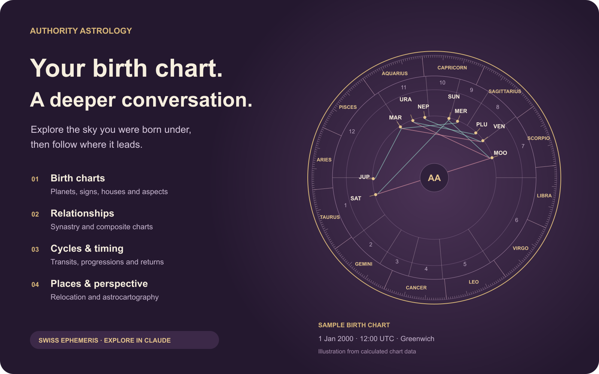

# Authority Astrology: Birth Chart Calculator


Your birth chart, relationships and planetary cycles, explored in Claude with Swiss Ephemeris calculations.



## What you can do

| Explore | What you can do |
| --- | --- |
| Birth charts | Calculate planets, signs, houses, angles and aspects from your birth details. |
| Relationships | Compare two charts with synastry, or calculate a composite chart. |
| Timing and cycles | Explore transits, secondary progressions, and solar, lunar or Saturn returns. |
| Places | Calculate relocated charts and astrocartography. |
| More chart techniques | Calculate horary and electional charts; look up eclipses, sky events and celestial positions. |
| Your saved details | Connect your account to choose saved people, retrieve raw charts and save a new calculation when you ask. |

## Try it in Claude

- “Calculate my birth chart and explain my Sun, Moon, rising sign and major aspects. Ask me for the details you need.”
- “Compare our birth charts with synastry and explain the cross-chart aspects.”
- “What transits affect my natal chart this month?”
- “Use my saved birth profile to calculate my next solar return.”

Calculations use Swiss Ephemeris; Claude supplies any explanation or interpretation. Birth-time uncertainty is preserved. Public calculations work without an account connection. Sign in only for saved profiles and charts. Astrology is for reflection and entertainment. The visual above illustrates a public synthetic sample for 1 January 2000 at 12:00 UTC in Greenwich, not an in-app screenshot.

## Real Claude examples


## Connect

Add this remote MCP URL as a custom web connector in Claude:

```text
https://authorityastrology.com/mcp/claude
```

Choose automatic OAuth client registration (DCR) and sign in when needed. Public tools do not require an account. The server supports S256 PKCE and refresh-token rotation. No API key belongs in this package or in chat.

For Claude Code, add the same endpoint with:

```sh
claude mcp add --transport http authority-astrology https://authorityastrology.com/mcp/claude
```

For a local checkout of this plugin package, run `claude --plugin-dir /absolute/path/to/plugin`. The plugin is published in the Claude directory. Updates appear after Anthropic publishes the new version.

## Data and privacy

The skills invoke only the declared Authority Astrology MCP server. The package runs no local scripts, hooks, installers or background processes. The hosted service receives tool arguments and, after OAuth consent, the account permissions needed for the requested action. It does not require the full conversation. Birthplace searches use LocationIQ. Birth details and calculated charts are personal data; saved charts follow the service retention and deletion policy. See the [privacy policy](https://authorityastrology.com/privacy-policy#connected-assistants), [terms](https://authorityastrology.com/terms) and [developer documentation](https://authorityastrology.com/developers) for details.

## Support

Use [Authority Astrology support](https://authorityastrology.com/support). If authorization expires or is revoked, reconnect through Claude. If a tool reports a rate limit, wait for its retry interval. Never infer missing results from a failed request.

## License

The plugin package is MIT licensed. Hosted services and their data remain subject to their own terms.

## Install from a local marketplace

```text
/plugin marketplace add /absolute/path/to/authority-astrology
/plugin install authority-astrology@authority-astrology-claude
```

The plugin files are MIT licensed. The remote service uses its own terms and privacy policy linked above. New directory versions are subject to Anthropic review.
